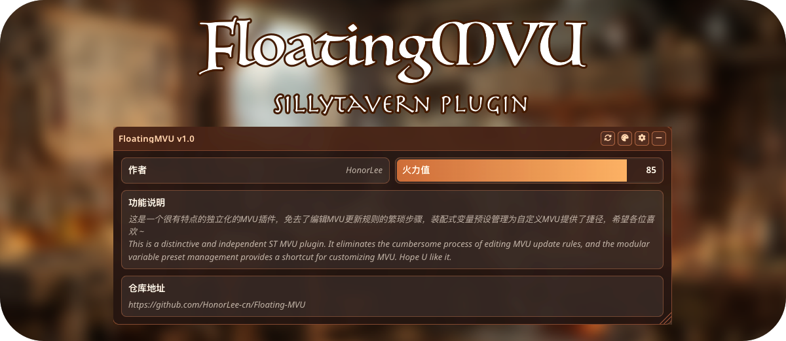
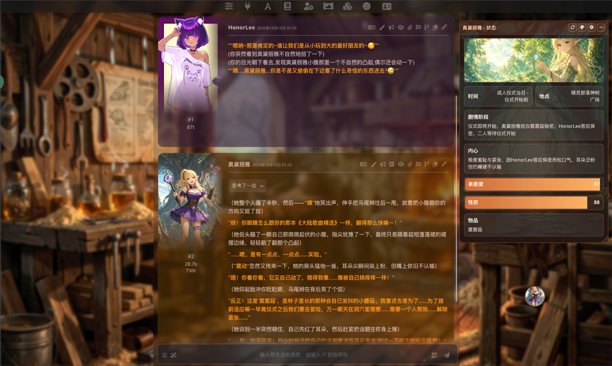
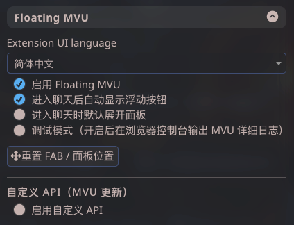
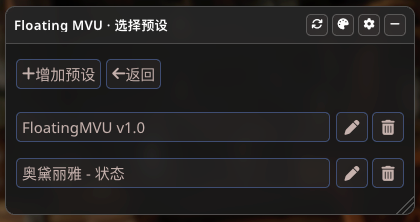
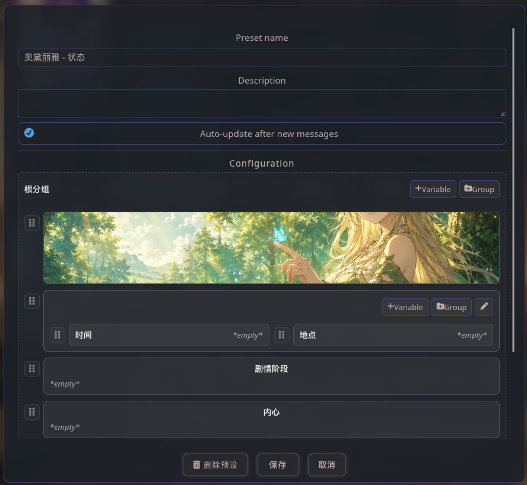
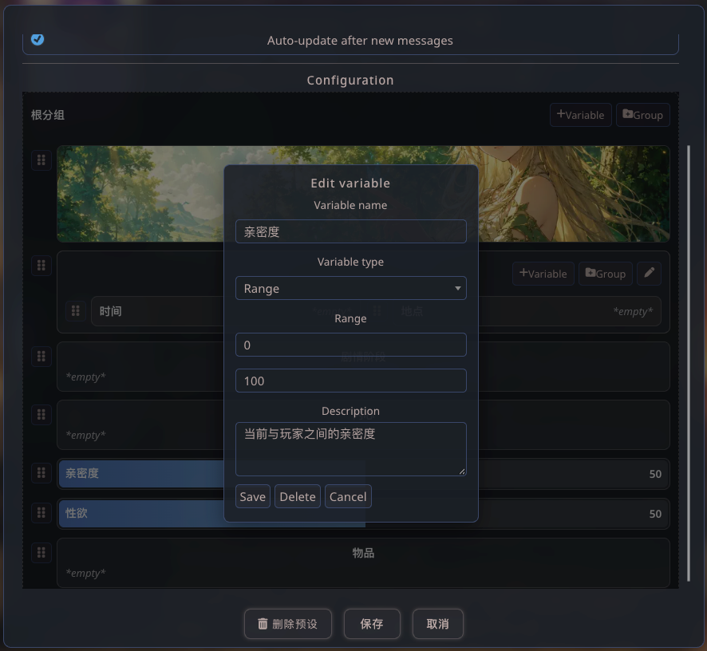
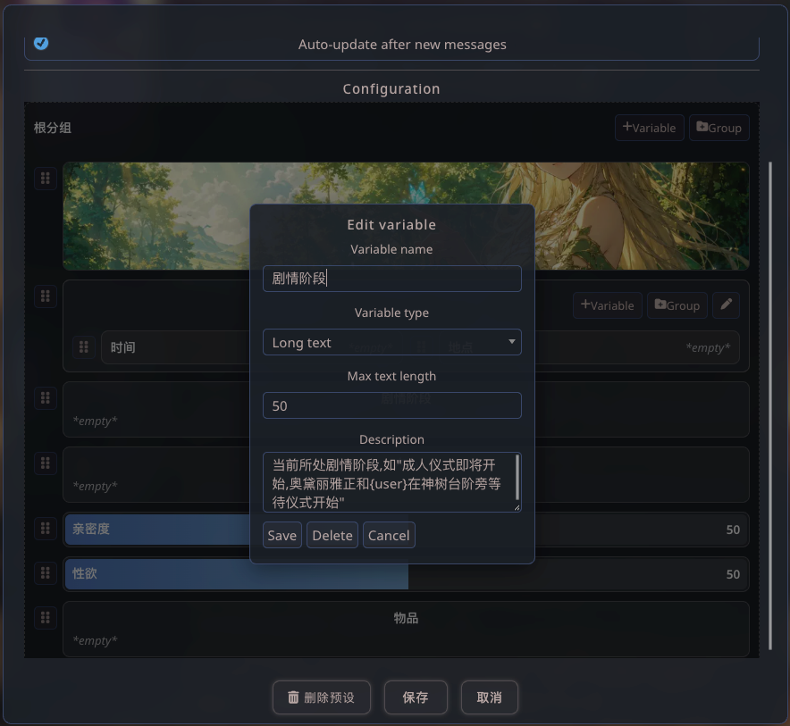
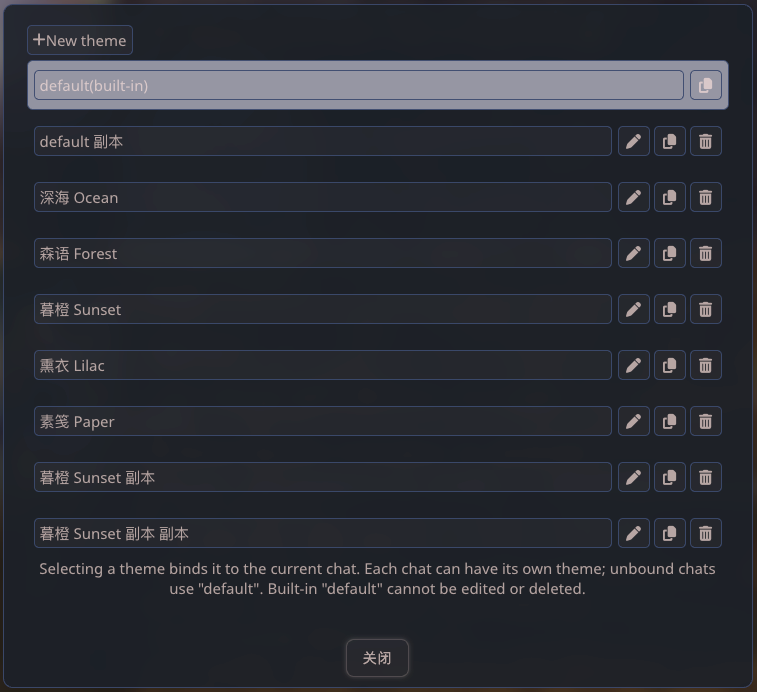
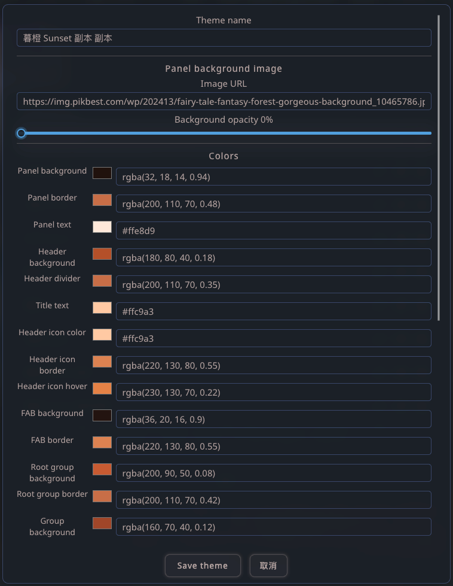

# Floating MVU

**Language / 语言:** [中文](README.md) · [English](README.en.md)

> 我是一个ST新手玩家，虽然比较精通HTML、CSS、JS，但又懒得每次都动手修改角色卡和世界书去适配MVU更新，便通过VibeCoding创建了这个MVU插件。

> 这是一个很有特点的独立化的MVU插件，免去了编辑MVU更新规则的繁琐步骤，装配式变量预设管理为自定义MVU提供了捷径，希望各位喜欢

<center>

[]()

</center>

**Floating MVU** 是 [SillyTavern](https://github.com/SillyTavern/SillyTavern) 的第三方扩展，在聊天界面提供可拖动的浮动面板，用于定义、展示并在对话过程中**自动追踪**角色/场景状态变量（MVU，Multi-Variable Update 思路）。

模型根据最近对话与变量定义，以 `<floating-mvu>{...JSON...}</floating-mvu>` 形式返回更新结果；扩展解析后写入当前聊天的 `chat_metadata`，并在面板上实时展示。预设配置全局保存，**每个聊天可绑定不同预设与主题**。

---

## 功能特性

<center>

[]()

```请务必无视本人的特殊癖好 ε==(づ′▽`)づ```

</center>

- **装配式自定义变量动态组装**：在预设编辑器里用「搭积木」方式配置变量（名称、类型、说明、范围/字数等），无需手写世界书或角色卡里的 MVU 规则。每次刷新/自动更新时，扩展会**按当前绑定的预设与聊天中的实时数值**，自动拼出完整 Prompt 块（角色上下文 → 最近对话 → 变量清单与约束 → 当前值 → 输出格式与语言约定），再交给模型返回 `<floating-mvu>` JSON；改预设结构即改 AI 侧追踪字段，无需改代码。
- **浮动 UI**：FAB 入口 + 可拖动/可缩放面板，位置与尺寸可记忆，支持重置。
- **MVU 预设**：多预设管理；变量支持**文本 / 长文本 / 范围数值 / 图片**；分组嵌套、拖拽排序。
- **聊天级绑定**：每个聊天独立选择 MVU 预设；变量值保存在该聊天的 metadata 中。
- **AI 更新**：手动刷新或（可选）在收到**角色消息**后自动更新；Prompt 与界面语言（中/英）一致，并在 footer 中约定文本变量返回语言。
- **双 API 通道**：默认走 SillyTavern 当前连接的生成接口；也可配置 **OpenAI 兼容**自定义 API（`/v1/chat/completions`）及模型列表拉取。
- **时间线同步**：删消息、切换 swipe 分支时，按快照恢复/丢弃变量，避免与对话不一致。
- **主题系统**：内置 `default` 主题；可新建/复制/编辑自定义主题（配色、背景图、自定义 CSS），**按聊天绑定**。
- **国际化**：Extension UI language（简体中文 / English）；设置项、面板、编辑弹窗与 MVU Prompt 随语言切换。
- **调试模式**：开启后在浏览器控制台输出装配 Prompt、API 请求与解析详情。

---

## 功能分类说明

### 1. 扩展设置（SillyTavern → 扩展 → Floating MVU）

| 分类 | 说明 |
|------|------|
| **Extension UI language** | 界面与 MVU Prompt 语言（`zh` / `en`）。 |
| **常规** | 启用扩展、进入聊天显示 FAB、默认展开面板、调试模式、重置 FAB/面板位置。 |
| **自定义 API（MVU 更新）** | 启用后 MVU 刷新/自动更新使用自定义 Base URL + API Key + Model；支持手动填模型或从 `/v1/models` 拉列表。未启用或未填完整时，使用 SillyTavern 内置 `generateRaw` 等路径。 |

<center>

[]()

</center>

### 2. 浮动面板

| 分类 | 说明 |
|------|------|
| **主视图** | 展示当前聊天已绑定预设的变量树与当前值；未绑定时可快速进入预设选择。 |
| **标题栏** | 预设名称、更新中状态、刷新（已绑预设时）、主题、预设与配置、收起。 |
| **交互** | 拖动标题移动面板；右下角缩放；小高度时仍可滚动内容区。 |

<center>

[]()

</center>

### 3. 预设与变量（齿轮 → 预设列表 / 编辑）

| 分类 | 说明 |
|------|------|
| **预设** | 新建/编辑/删除；名称、描述、是否「接收对话后自动更新」。 |
| **变量类型** | **文本**、**长文本**（可选字数上限）、**范围数值**（min/max）、**图片**（URL + 显示高度；不参与 MVU Prompt 装配）。 |
| **结构** | 分组嵌套；配置面板内添加变量/分组、编辑、删除、拖拽排序。 |
| **只读展示** | 主面板中点击变量块可打开编辑（配置流程在预设编辑器内）。 |

<center>

[]()

</center>

### 4. 装配式 Prompt 动态组装（核心）

无需在角色卡/世界书中维护大段 MVU 说明。你在 UI 里维护的**预设 = 变量 schema**，每次更新由扩展在运行时生成发给模型的说明文本：

| 装配块 | 来源 | 说明 |
|--------|------|------|
| 系统提示 | i18n + 固定职责 | 状态追踪助手、只输出 `<floating-mvu>` JSON 等。 |
| 角色与用户 / 描述 | 当前角色卡 `description`、`name1`/`name2` | 随聊天角色变化。 |
| 最近对话 | 当前聊天尾部若干条消息 | 默认条数可配置逻辑内限定，供模型读剧情。 |
| 变量清单 | **当前预设**中非图片变量 | 逐条输出：类型、说明、范围或字数约束、**当前聊天已存值**；含示例 JSON 结构。 |
| 格式 footer | i18n | 严格格式 + 文本变量返回语言约定。 |

图片类变量仅用于面板展示，**不参与**上述 Prompt 装配。切换预设、增删变量或修改约束后，下一次刷新即使用新 schema，实现「装配式」自定义 MVU。

<center>

[]()
[]()
[]()

</center>

### 5. MVU 更新链路

| 步骤 | 说明 |
|------|------|
| 装配 | 按上一节动态生成 `userPrompt` / `systemPrompt`（见 `buildMvuUpdateRequest`）。 |
| 调用 | 非 streaming 请求；解析回复中的 `<floating-mvu>` JSON。 |
| 写入 | 校验变量名与类型后写入 `chat_metadata.floating_mvu.values`；记录快照（锚点消息索引 + 分支 pathKey）。 |
| 触发 | 标题栏刷新按钮；或 `MESSAGE_RECEIVED`（角色非空消息，且预设开启自动更新）。 |

### 6. 主题（调色板）

| 分类 | 说明 |
|------|------|
| **管理** | 选择主题并绑定**当前聊天**；切换聊天使用各自绑定（未绑定则用 `default`）。 |
| **编辑** | 主题名、面板背景图及透明度、多项 CSS 变量配色、可选自定义 CSS（作用域为浮动面板）。 |
| **内置** | `default` 不可编辑/删除；可复制为自定义主题再改。 |

<center>

[]()
[]()

</center>

### 7. 数据与存储

| 数据 | 存储位置 |
|------|----------|
| 扩展设置、预设列表、自定义主题 | `extension_settings.floating_mvu` |
| 当前聊天绑定的预设 ID、主题 ID、变量值、快照 | 该聊天的 `chat_metadata.floating_mvu` |

---

## 安装方法

### 环境要求

- 已安装并可正常运行的 **SillyTavern**（支持第三方扩展加载）。
- **SillyTavern 所在机器**需已安装 **Git**，且服务端有权限执行 `git clone`（通过界面安装时会自动克隆仓库）。
- 浏览器建议使用 Chromium 内核近期版本。

### 安装步骤

#### 方式一：在 SillyTavern 内通过 Git 地址安装（推荐 / 默认）

SillyTavern 支持在 Web UI 中直接填写 Git 仓库 URL 安装第三方扩展，无需手动拷贝文件。

1. 打开 SillyTavern → 侧栏 **Extensions（扩展）** 区域。
2. 点击 **Install extension（从 Git 仓库安装扩展）** 按钮（云下载图标）。
3. 在弹窗中填写本仓库地址：

   ```text
   https://github.com/HonorLee-cn/Floating-MVU.git
   ```

4. （可选）在 **Branch or tag name** 中指定分支或标签；留空则使用仓库默认分支。
5. 确认第三方扩展安全提示后安装：
   - 普通用户：**Install just for me / Install** — 扩展安装到**当前用户**的扩展目录。
   - 管理员还可选 **Install for all users** — 安装到全局目录 `public/scripts/extensions/third-party/`（本机所有用户可用）。
6. 安装成功后，在扩展列表中找到 **Floating MVU**（磁盘路径一般为 `third-party/Floating-MVU`，名称取自仓库名），点击 **Enable** 启用。
7. 在 **Floating MVU** 设置抽屉中配置 Extension UI language、FAB、自定义 API 等。

> **说明**：通过 Git URL 安装时，本地文件夹名通常为 `Floating-MVU`（与 GitHub 仓库名一致），在 SillyTavern 中显示为 `third-party/Floating-MVU`。这与手动放入的 `FloatingMVU` 文件夹名不同，但均为合法第三方扩展路径，任选其一即可，不要重复安装两份。

#### 方式二：命令行手动克隆（进阶）

适用于无法使用 UI 安装、或需自行指定目录名的环境：

```bash
cd /path/to/SillyTavern/public/scripts/extensions/third-party
git clone https://github.com/HonorLee-cn/Floating-MVU.git
```

克隆后路径示例：`.../third-party/Floating-MVU/manifest.json`。然后在扩展列表中启用 **Floating MVU**。

#### 方式三：手动复制

下载 [GitHub 仓库](https://github.com/HonorLee-cn/Floating-MVU) 的 ZIP 或 Release 包，解压到 `public/scripts/extensions/third-party/` 下**任意未占用的文件夹名**（需包含有效的 `manifest.json`）。

目录内应包含至少：`manifest.json`、`index.js`、`style.css`、`settings.html`、`LICENSE` 及子目录（`i18n/`、`mvu/`、`ui/`、`theme/` 等）。

#### 在聊天中使用

- 进入任意角色聊天，确认 FAB 显示（需在设置中启用且允许「进入聊天后自动显示」）。
- 点击 FAB 打开面板 → **预设与配置** → 选择或新建预设并绑定到当前聊天。
- 在预设编辑器中配置变量后，使用标题栏 **刷新** 或等待自动更新，即可在面板看到变量变化。

### 更新扩展

**通过 Git 安装的扩展**（方式一 / 二）：

1. 打开 **Extensions** → **Manage extensions（管理扩展）**。
2. 在 **Floating MVU** 条目上点击 **Update（更新）**，从远程仓库拉取最新提交。

也可在扩展目录手动执行 `git pull`（路径以你本机为准，例如 `third-party/Floating-MVU`）。

**手动复制安装的扩展**（方式三）：用新版本文件覆盖对应文件夹。

更新后建议刷新浏览器。如有需要，可先备份 `extension_settings` 中与 `floating_mvu` 相关的配置。

### 卸载

1. 在 **Manage extensions** 中禁用并 **Delete** 该扩展（若为 Git 安装，会一并处理仓库目录；具体以 SillyTavern 版本行为为准），或手动删除 `third-party/Floating-MVU`（或你使用的文件夹名）。
2. 已写入各聊天 `chat_metadata` 的数据不会自动清除，卸载后仅不再读取。

---

## BUY ME A COFFEE
<center>

<table>
  <tr>
    <td></td>
    <td>~</td>
    <td></td>
  </tr>
</table>

</center>
<!-- []()
[]() -->

---

## 版权与许可

```
Floating MVU (SillyTavern extension)
Copyright (C) 2026 HonorLee

This program is free software: you can redistribute it and/or modify
it under the terms of the GNU General Public License as published by
the Free Software Foundation, either version 3 of the License, or
(at your option) any later version.
```

本扩展以 **GNU General Public License v3.0（GPLv3）** 发布。完整许可证正文见仓库根目录 [`LICENSE`](LICENSE) 文件。

- 你可以自由使用、修改和再分发本扩展，但再分发（含修改版）须遵循 GPLv3（包括以相同许可证公开对应源代码等义务）。
- 本扩展为 SillyTavern **第三方**插件，与 SillyTavern 主项目及其许可证相互独立；与 SillyTavern 一并使用时，请同时遵守 SillyTavern 的相关条款。
- 使用自定义 API 时请自行遵守相应服务条款，并妥善保管 API Key。